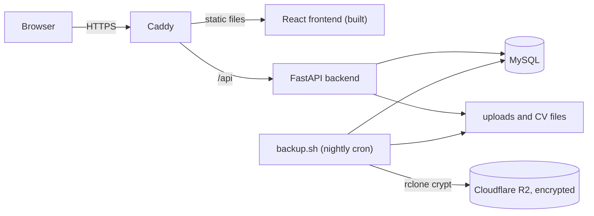

# andriguez.dev
 
An interactive portfolio that looks like a retro terminal, with a second mode styled as a desktop file explorer. Both modes show the same content, which is managed through a small CMS behind two-factor login.
 
**Live:** https://andriguez.dev


 
## Contents
 
- [What it does](#what-it-does)
- [Architecture](#architecture)
- [Tech stack](#tech-stack)
- [Running it locally](#running-it-locally)
- [Tests](#tests)
- [Security decisions](#security-decisions)
- [Deployment and operations](#deployment-and-operations)
- [Project structure](#project-structure)
- [Known issues and next steps](#known-issues-and-next-steps)
## What it does
 
- **CLI mode:** type commands like `ls`, `cd`, `cat`, `help` and `whoami`. Paths, Tab completion and command history work as in a real shell, and output is rendered as formatted pages, not raw text.
- **GUI mode:** the same content as folders and files in a file-explorer window, with a tree view, grid and list views, search, and a detail panel.
- **Content as a virtual file system:** folders are topics, files are pages. Everything is stored in MySQL and edited through the CMS, so new write-ups don't need a redeploy.
- **CMS:** an admin panel to create, edit, move and delete pages, upload images and CVs, and manage links. It's protected by a password plus TOTP two-factor authentication.
## Architecture
 

 
- **Caddy** terminates TLS, sets the security headers, serves the built frontend and forwards `/api` to the backend. It is the only container with published ports.
- **FastAPI** serves the content API and the CMS endpoints, and handles authentication.
- **MySQL** stores the content tree, CV metadata and the 2FA data. It is only reachable on the internal Docker network.
- Everything runs with **Docker Compose** on a single Hetzner VPS.
## Tech stack
 
| Layer | Technology |
| --- | --- |
| Frontend | React, TypeScript, Vite, React Router, DOMPurify |
| Backend | Python, FastAPI, SQLAlchemy, Alembic, pydantic, slowapi, pyotp, bcrypt |
| Database | MySQL |
| Infrastructure | Docker Compose, Caddy, Ubuntu on Hetzner, Cloudflare (DNS, R2) |
| CI | GitHub Actions: lint, `pip-audit`, `npm audit`, gitleaks, migration check, pytest, Vitest |
 
## Running it locally
 
**Requirements:** Docker with Docker Compose, Node.js and npm (for frontend development), and optionally Python with a virtual environment (to run the backend tests outside Docker).
 
```bash
git clone https://github.com/andriguez/portfolio.git
cd portfolio/deploy
 
# 1. Create your local settings from the example and fill in your own values
cp .env.example .env
 
# 2. Start the database and the backend; migrations run when the backend starts
docker compose -f docker-compose.dev.yml up --build
```
 
The compose file starts the backend and the database only. Start the frontend dev server in a second terminal:
 
```bash
cd frontend
npm ci
npm run dev
```
 
- The site runs at the address Vite prints (by default `http://localhost:5173`).
- To set the admin password, create a bcrypt hash with `docker run --rm -it caddy:2 caddy hash-password` and put it in `deploy/.env` as `ADMIN_PASSWORD_HASH='...'` (single quotes, because the hash contains `$` signs).
- The CMS is at `/admin`. Locally you can log in with the password only; 2FA can be enrolled from the CMS.
- The root folder of the content tree is created automatically on first start.
**Creating a migration** after changing a model (from `deploy/`, with the backend folder mounted so the file lands in the repo):
 
```bash
docker compose -f docker-compose.dev.yml run --rm -v "$(pwd)/../backend:/app" backend \
  alembic revision --autogenerate -m "describe the change"
```
 
## Tests
 
**Backend** (pytest with FastAPI's `TestClient`, against a throwaway in-memory SQLite database):
 
```bash
cd backend
pip install -r requirements-dev.txt
pytest -v
```
 
The auth suite covers the security claims below:
 
- a wrong password is refused (401);
- after 2FA is set up, the password alone gives only a pending token, and `/api/me` refuses it, even when the pending token is presented as an access token;
- password plus a valid TOTP code gives full access;
- a TOTP code can't be replayed;
- a recovery code works exactly once, and using one doesn't burn the others;
- the 6th login attempt within a minute is rate-limited (429).
**Frontend** (Vitest, for the pure path and parsing helpers such as `resolvePath` and `tokenize`):
 
```bash
cd frontend
npm ci
npm test
```
 
Both suites run in CI on every push and pull request.
 
## Security decisions
 
**Authentication**
- Admin login is a password check followed by a TOTP code (two-factor), with one-time recovery codes.
- Passwords and recovery codes are hashed with bcrypt; the TOTP secret is stored encrypted.
- After the password step, the browser only gets a short-lived `pending_2fa` cookie, scoped to `/api/login`, so it is never sent to the rest of the API. Full access needs the second step.
- Session tokens are JWTs in `HttpOnly`, `Secure`, `SameSite=Lax` cookies, so page scripts can't read them.
- TOTP codes are single-use (replay protection).
- In development, when no 2FA is enrolled, the password alone is accepted. In production, 2FA has been enrolled since launch.
**Abuse protection**
- Login is rate-limited to 5 attempts per minute **per visitor IP**. The backend trusts the proxy headers from Caddy so each visitor gets their own limit; this is safe because the backend port is not published.
**Input handling**
- Page content is stored as HTML and sanitised with DOMPurify before rendering.
- Uploads are checked by their file signature (magic bytes), not just by extension or MIME type.
- Slugs are validated (`^[a-z0-9_-]+$`), unique per folder (database constraint), and reserved names like `cv` and `trash` can't be used in the root. Moves that would put a folder inside itself are refused, and the root can't be renamed, moved or deleted.
**HTTP hardening (Caddy)**
- HSTS, a Content-Security-Policy, `X-Frame-Options: DENY` (clickjacking protection for the admin), `Permissions-Policy` and `Cross-Origin-Opener-Policy`.
- The `Server` header from the backend is removed, and unknown sensitive paths such as `/.env` and `/.git/` return real 404s.
- Hashed static assets are cached long-term; CV downloads are served with `Cache-Control: no-store`.
**Containers and infrastructure**
- Only Caddy publishes ports; MySQL and the backend are on the internal Docker network.
- The backend container runs with a read-only root file system, in development and production.
- Secrets live in a `.env` file that is not in the repository; gitleaks scans every commit in CI, and the git history was cleaned of an old `.env`, with every secret in it rotated.
- Dependencies are audited in CI (`pip-audit`, `npm audit`).
<!-- TODO after WireGuard: "SSH and the admin are only reachable through a WireGuard tunnel; public requests to the admin routes get a 404." -->
 
**Backups**
- A nightly cron job dumps the database and archives the uploads, then copies both to Cloudflare R2 through an **rclone crypt** remote, so file contents and names are encrypted before they leave the server. Copies older than 14 days are removed.
## Deployment and operations
 
- Changes go one way: **PC → GitHub → server**. Nothing is edited on the server by hand; `deploy/deploy.sh` applies changes and takes a backup first.
- Server setup, deploys, the backup schedule and the restore procedure are documented in [`docs/DEPLOY.md`](docs/DEPLOY.md).
- An external uptime monitor watches the site and the API.
- The server is being hardened against the CIS Ubuntu Linux Level 1 benchmark, with Lynis and Docker Bench scans before and after.
## Project structure
 
```
frontend/            React + TypeScript app (CLI mode, GUI mode, CMS)
backend/
  app/               FastAPI app: routers, models, schemas, auth
  migrations/        Alembic migrations
  tests/             pytest suite
deploy/              Docker Compose files, Caddyfile, deploy.sh, backup.sh
docs/                DEPLOY.md, screenshots
.github/workflows/   CI
```
 
## Known issues and next steps
 
**Known issues**
- When no 2FA is enrolled, the password alone gives full access. This is intended for development; production has 2FA enrolled.
- GUI search matches names only, not page content.
- An accessibility pass (keyboard navigation, focus states, contrast) is still to do.
**Next**
- WireGuard in front of SSH and the admin routes.
- Automated deploys from CI instead of running `deploy.sh` by hand.
- The changelog as a file in the root folder, generated from conventional commits with release-please, starting at v1.0.
- **aeon:** a separate, self-defending security system that the portfolio will connect to (rate rules, metrics, honeypot).
## Acknowledgements
 
I designed this project and made its architecture, design and security decisions. I used Claude (Anthropic) as an assistant along the way: to explain tools that were new to me, suggest implementations, review my code and help with debugging. Everything that went into the repository I reviewed, adapted where needed, and tested myself.
 
## License
 
No license: all rights reserved. You're welcome to read the code and learn from it, but please don't reuse it as your own.
 
